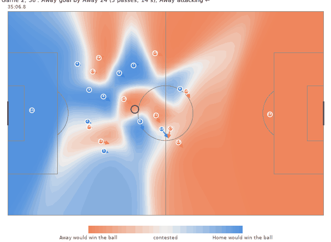
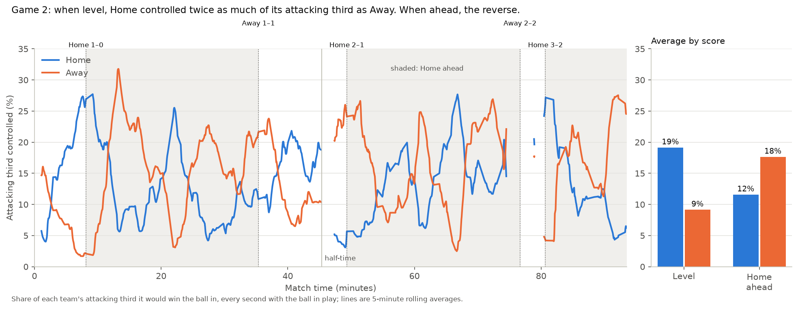

# Pitch Control on Metrica Sports Tracking Data

An implementation of William Spearman's pitch-control model (*Beyond Expected Goals*, 2018), built from
scratch, validated against the best-known open implementation, and used to analyse a full match.



*Game 2, 36th minute: Away intercepts on the halfway line and scores 14 seconds and five passes later. Blue: Home
would win the ball there. Orange: Away would. Plays in real time.*

## What is pitch control?
For any moment in a match, the model answers one question: **if the ball were played to this spot right
now, which team would most likely win it?** It takes into account where every player is, which way and how fast
they're running, and how long the ball would take to get there. Asking that question for every spot on the pitch
gives a map of the space each team controls.

## Findings (Game 2, a 3–2 Home win)

**1. Space followed the scoreline.** While the score was level, Home controlled twice as much of its attacking
third as Away did (19% vs 9%). Once Home went ahead, it reversed (12% vs 18%), while possession barely changed.



**2. The model's probabilities match what actually happened.** Passes into space the model gives the passing team
0.4–0.6 control arrived 61% of the time; passes into space with 0.8 or more control arrived 99% of the time.
Forward passes into contested space succeeded only 35% of the time.

These describe one match, not general laws. The [analysis notes](docs/methodology/06_analysis.md) cover the
caveats, including why the pass check somewhat flatters the model.

## How it works
1. **Data:** three anonymised matches from Metrica Sports, in two formats (CSV and FIFA EPTS), loaded into one
   structure in metres. The Home team always attacks to the right. → [notes](docs/methodology/01_data_loading.md)
2. **Velocities:** calculated from positions with Savitzky-Golay smoothing, a 12 m/s speed cap and a 10 m/s²
   acceleration limit. The acceleration limit was added after the data showed tracking glitches that the
   standard speed cap misses. → [notes](docs/methodology/02_velocities.md)
3. **Model:** each player keeps moving at their current velocity for 0.7 s (reaction time), then runs at 5 m/s
   to the target. Arrival times are uncertain (σ = 0.45 s). Once the ball arrives, players gain control at a fixed
   rate, and the resulting equation is solved over time. Fully vectorised: about 25 ms per frame.
   → [notes](docs/methodology/03_pitch_control.md)
4. **Validation:** with identical inputs, the output matches Laurie Shaw's
   [Friends of Tracking code](https://github.com/Friends-of-Tracking-Data-FoTD/LaurieOnTracking) to within
   0.000001. The remaining differences were traced to a shortcut in the reference that ignores players who arrive
   at the same time as a slow ball, and to a more accurate integration step. About 30× faster than the
   reference. → [notes](docs/methodology/04_validation.md)

## Quick start
Requires Python 3.11+.

```bash
python -m venv .venv
.venv\Scripts\activate              # Windows; macOS/Linux: source .venv/bin/activate
pip install -r requirements.txt
pip install -e .
python scripts/download_data.py     # ~175 MB of Metrica sample data into data/raw/
pytest                              # 71 tests
```

Then open [`notebooks/demo.ipynb`](notebooks/demo.ipynb) for a walkthrough, or use the package directly:

```python
from pitch_control.loaders import load_match
from pitch_control.velocities import add_velocities
from pitch_control.model import make_grid, pitch_control_at_frame

match = load_match(2)
tracking = add_velocities(match.tracking, match.fps)
goalkeepers = {team: match.goalkeeper(team) for team in ("Home", "Away")}
surface = pitch_control_at_frame(tracking, frame=73955, attacking_team="Home",
                                 goalkeepers=goalkeepers, grid=make_grid(match.pitch, n_x=50))
surface.attack   # (32, 50) probability that Home would win the ball in each cell
```

| Script | Produces |
|---|---|
| `scripts/plot_pitch_control_frame.py` | Pitch-control map for one moment |
| `scripts/animate_goal.py --goal N` | GIF of the attack leading to goal N |
| `scripts/analyse_match.py` | Final-third and pass analysis (figures and CSVs) |
| `scripts/validate_against_reference.py` | Frame-by-frame comparison with the reference code |
| `scripts/plot_velocity_cleaning.py` | Raw vs cleaned player speeds |

All model parameters (reaction time, speeds, control rates, grid resolution) are in
[`config.py`](src/pitch_control/config.py).

## Repository structure
```
src/pitch_control/   loaders, velocities, model, analysis, plotting, config
scripts/             data download, figures, animation, analysis, validation
tests/               unit tests and integration tests on the real data
notebooks/           demo notebook
docs/methodology/    short explanations of every step, with figures
outputs/             figures, animation, analysis and validation results
```

## Limitations
- **Every ball is treated as a pass along the ground at 15 m/s.** The model doesn't know about crosses, headers
  or who is better in the air. Home's second goal was a header won at a spot where, at the moment of the cross,
  the model gave Home only 16% control.
- **Every player gets the same speed and reaction time.** Real players differ.
- **One match analysed.** The findings describe Game 2 and aren't general conclusions.
- **Data glitches:** a few seconds of tracking contain impossible movement that can't be fully repaired.

## Credits
- **Data:** [Metrica Sports sample data](https://github.com/metrica-sports/sample-data)
- **Model:** W. Spearman (2018), *Beyond Expected Goals*, MIT Sloan Sports Analytics Conference
  ([copy](https://github.com/eddwebster/football_analytics/blob/master/research/papers/%5B2018%5D%20Beyond%20Expected%20Goals%20-%20William%20Spearman.pdf);
  the original conference link no longer works). Its core assumptions are also stated in
  [Dop (2022)](https://staff.science.uva.nl/a.visser/education/masterProjects/Thesis_Ramon_Dop_MsDS.pdf).
- **Reference implementation used for validation:** Laurie Shaw,
  [LaurieOnTracking](https://github.com/Friends-of-Tracking-Data-FoTD/LaurieOnTracking) (Friends of Tracking).
  It's downloaded at run time and isn't included in this repository.
- **All papers and sources**, including those behind the velocity limits: [references](docs/methodology/references.md)

## License
The code is released under the [MIT License](LICENSE). The tracking and event data belong to Metrica Sports,
aren't included in this repository, and are subject to Metrica's own terms.
