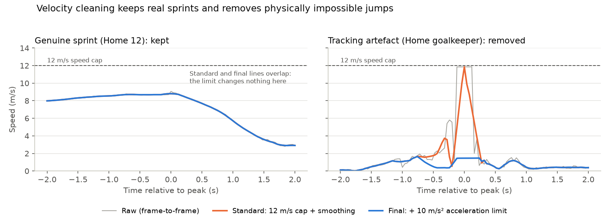

# 2. Player velocities

Code: [`velocities.py`](../../src/pitch_control/velocities.py). Settings: `VelocityConfig` in [`config.py`](../../src/pitch_control/config.py).
Figure: `python scripts/plot_velocity_cleaning.py`.

The pitch-control model predicts where each player will be about 0.7 s from now,
so it needs every player's velocity. Tracking data only gives positions, so the
velocity has to be calculated, and then cleaned.

## Four steps (each half separately, so changing ends doesn't count as movement)
1. **Raw velocity:** change in position ÷ 0.04 s. Centimetre-level jitter in
   the positions becomes large speed noise (the grey line).
2. **Speed cap (12 m/s):** faster steps are tracking errors. They're removed and
   filled in from the neighbouring frames.
3. **Savitzky-Golay smoothing:** fits a straight line to each 7-frame (0.28 s)
   window and keeps the value at its centre. It removes jitter but still follows
   real changes of pace.
4. **Acceleration limit (10 m/s²):** velocity may change by at most 0.4 m/s per
   frame. The limit is applied forwards and backwards in time, and the two
   results are averaged so the timing isn't shifted.

## Why step 4 was added
Steps 1–3 are the standard method. Inspecting the data turned up artefacts the
speed cap misses, because they're too *sudden* rather than too *fast*: a player
jumps from standing still to a constant 11.85 m/s in one frame, moves in a
perfect straight line, then stops instantly. That would take about 300 m/s²;
elite sprinters reach about 10. In the data, 99% of smoothed accelerations are
below 5 m/s², while artefacts reach 40+ m/s².

## Effect
- **Real sprints are untouched** (left panel). The top 1% of speeds barely
  changes (e.g. 5.99 → 5.96 m/s), and only 0.1–0.2% of frames change by more
  than 0.5 m/s.
- **Artefacts are removed:** the goalkeeper's fake 11.9 m/s drops to 1.5 m/s
  (right panel).
- **Limitation:** in a few frames (e.g. a 2-second "glide" in Game 2) the
  *positions* are wrong too. This can't be repaired from the data.
- `max_acceleration=None` turns step 4 off, which gives exactly the standard
  method for comparison with the reference code.
