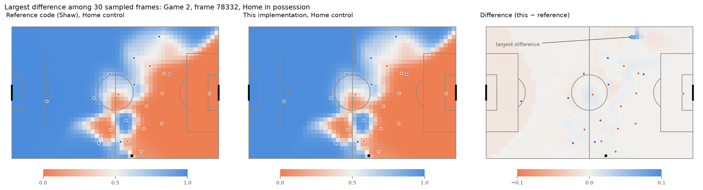

# 4. Validation

Script: `python scripts/validate_against_reference.py`; results in
`outputs/validation/reference_comparison.csv`. Tests: [`test_model.py`](../../tests/test_model.py),
[`test_reference.py`](../../tests/test_reference.py).

The model was compared with the best-known open implementation, Laurie Shaw's
Friends of Tracking code (pinned to commit `7ed3ff8`). Both got **identical
inputs**: 30 pass moments spread over Game 2, the same positions and
velocities, and a 106 × 68 m pitch. Any difference therefore comes from the
model code alone.

## Results (30 frames, 1,600 points each)
| Comparison | Max difference | Mean difference | What it shows |
|---|---|---|---|
| This code (Euler step) vs reference without shortcuts | **0.000000** | 0.000000 | The equations are implemented identically |
| Reference with shortcuts vs without | 0.11 | 0.0013 | Effect of the reference's speed-up shortcuts |
| This code (exact step) vs reference without shortcuts | 0.04 | 0.0015 | Effect of the more accurate time step |
| **This code (default) vs reference as published** | 0.11 | 0.0027 | Overall difference |

Both teams' control adds up to between 99% and 100% at every point in every
frame (also tested on 80 random in-play frames).

## Where the differences come from
1. **The reference skips some players.** To save time, the reference ignores
   any player who arrives more than 3.3 s after their fastest teammate. That
   goes wrong when the ball takes a long time to arrive. In the figure, Home 8
   reaches a far-away point in 0.8 s, but the ball needs 4.2 s. Home 9 arrives
   at 4.2 s, together with the ball, yet the reference ignores him because
   he's 3.4 s behind Home 8. With this shortcut turned off, the two
   implementations agree exactly. This implementation doesn't use the shortcut.
2. **A more accurate time step.** Checked against a very fine time step (the
   "true" answer), this code's maximum error is 0.014–0.016, while the
   reference's Euler step reaches 0.024–0.041. Most of the remaining error is
   the 1% stopping tolerance.
3. **Small gaps of 0.01 elsewhere:** where one team clearly dominates, the
   reference returns exactly 100%. This code integrates until 99% is assigned.

## Speed
About **25 ms per frame**, against about 790 ms for the reference: roughly 30×
faster, because all points and players are computed at once with NumPy.
