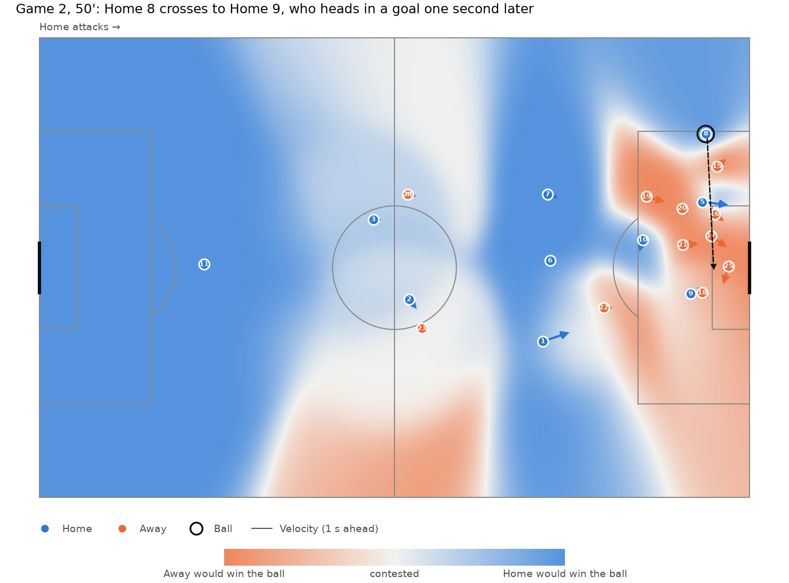

# 5. Visuals

Code: [`plotting.py`](../../src/pitch_control/plotting.py).
Figures: `python scripts/plot_pitch_control_frame.py` and `python scripts/animate_goal.py`.

## How to read the pictures
- **Blue** areas: Home would win the ball if it were played there. **Orange**: Away would. **Light grey**: contested.
- **Dots** are players (shirt numbers inside). The **arrows** show where each player will be one second later at their current speed.
- The **black ring** is the ball. It's drawn as a ring so it never hides the number of the player on it.
- Colours always refer to the team (blue = Home), whichever team has the ball, so frames can be compared directly.

## One moment: the cross before Home's second goal

Away's defence controls most of its penalty area, but there's a gap at the far
side. Home 9 attacks that space, and Home 8's cross (dashed arrow) is played into it.

## A whole attack: Away's counter-attack goal

Away intercepts on the halfway line and scores 14 seconds and five passes
later. As Away pushes forward, the orange area spreads into Home's half, and
Home's control shrinks back towards its own goal.

## Choices
| Choice | Why |
|---|---|
| **GIF format** | Plays directly in a GitHub README with nothing to install |
| **Real-time playback** | Every 3rd frame (8.3 per second) is shown at 120 ms each, so 1 second in the animation is 1 second of match time |
| **Shared 48-colour palette** | The surface changes everywhere in every frame, so GIF compression barely helps. A reduced palette cuts the file from 20 MB to 4 MB. |
| **Automatic attack detection** | The animation starts just after the other team last touched the ball, found by stepping back through the events from the goal. `--goal N` animates any goal. |
