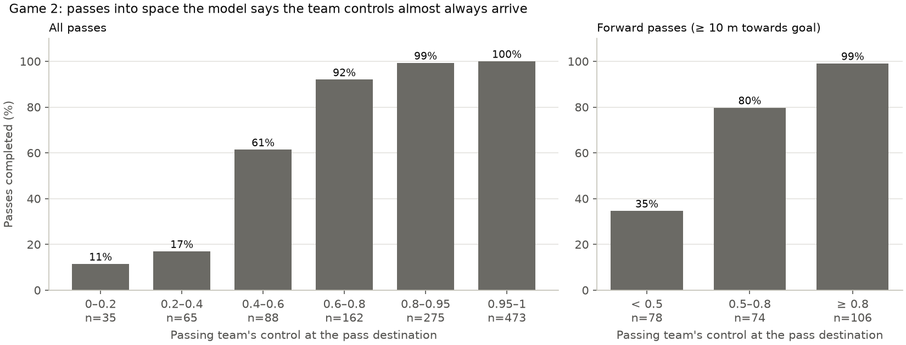

# 6. Match analysis (Game 2, 3–2 Home win)

Code: [`analysis.py`](../../src/pitch_control/analysis.py). Run: `python scripts/analyse_match.py`
(results cached in `outputs/analysis/`).

Two questions, both asked of the same model: *if the ball went here, who would win it?*

## 1. Who controls the dangerous space, and does it follow the score?
Every second with the ball in play (3,334 moments), the model draws the
control map. We measure what share of its **attacking third** each team would
win the ball in.

| Score state | Time (ball in play) | Home controls | Away controls | Home possession |
|---|---|---|---|---|
| Level (0–0, 1–1, 2–2) | 17 min | **19%** | 9% | 56% |
| Home ahead (1–0, 2–1, 3–2) | 38 min | 12% | **18%** | 49% |

**Finding:** when the score was level, Home controlled twice as much of its
attacking third as Away did. Once Home went ahead, the pattern reversed: Away
gained space near Home's goal. This is a classic "game state" pattern: the
leading team drops deeper. Here it's measured in terms of space, not just
possession, which barely changed (56% → 49%).

Four of the five goals came after the scoring team had above-average
final-third control in the preceding 5 minutes (for example, Home's 8th-minute
opener: 27% against a match average of 14%). The exception is Home's 49th-minute
goal, which came at about average control.

## 2. Where were passes played?
For each pass (1,098 in total: 964 completed and 134 intercepted), we take the
passing team's control at the **spot where the pass ended**, at the moment it
was played.

**Finding:**
- The model's probabilities line up closely with what happened. Passes into
  space with 0.4–0.6 control were completed 61% of the time; above 0.8,
  almost always.
- **Forward passes** (10 m or more towards goal) show the trade-off between
  progress and risk. Into contested or opponent space (control under 0.5), only
  35% succeeded; into well-controlled space (0.8 or more), 99%.
- Most completed forward passes into low-control space were long balls from the
  goalkeepers (Home 11, Away 25). They gained a lot of ground but were
  low-probability by design.

## Limitations
- **One match.** These are descriptions of Game 2, not general laws. Moments a
  second apart are strongly related, so the 3,334 samples are not 3,334
  independent observations.
- **Score effects aren't proof of cause.** The scoreline, fatigue,
  substitutions and tactics all change together.
- **The pass check flatters the model.** For an intercepted pass, the event
  data records where it was *intercepted*, not where the passer aimed. By
  definition a defender reached that spot, so the model will rate it as
  defender territory. Completed and intercepted passes separate very well
  (AUC 0.97), but some of that comes from how the data is recorded.
- **Passes at restarts are skipped** when the ball isn't tracked, because the
  model then can't compute the ball's travel time.
- **Possession** for each moment comes from the most recent possession event
  (pass, recovery, set piece, shot), which is approximate around challenges.
